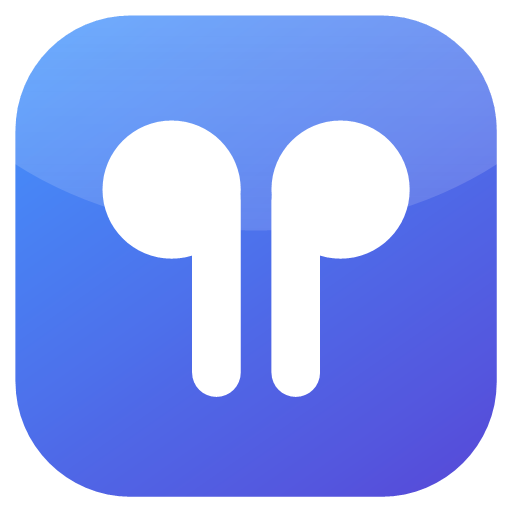
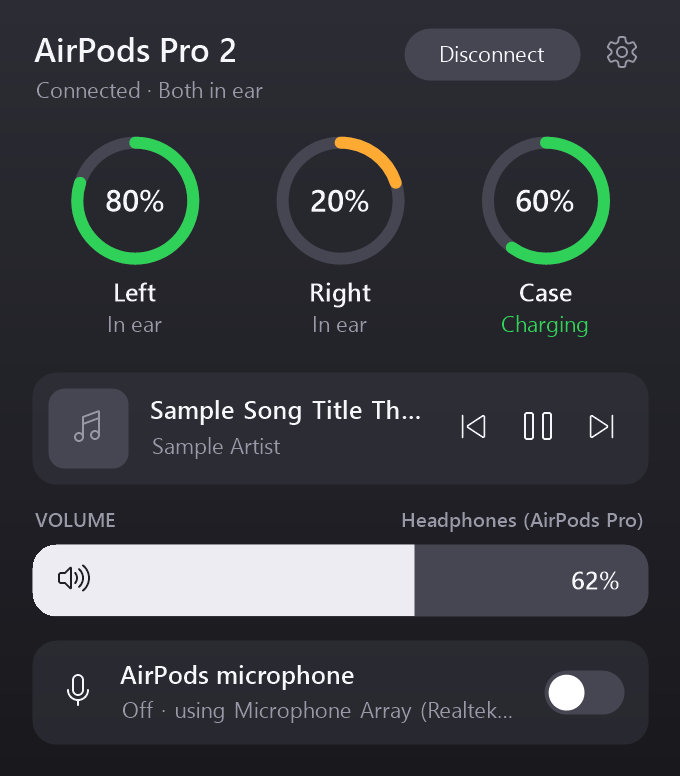
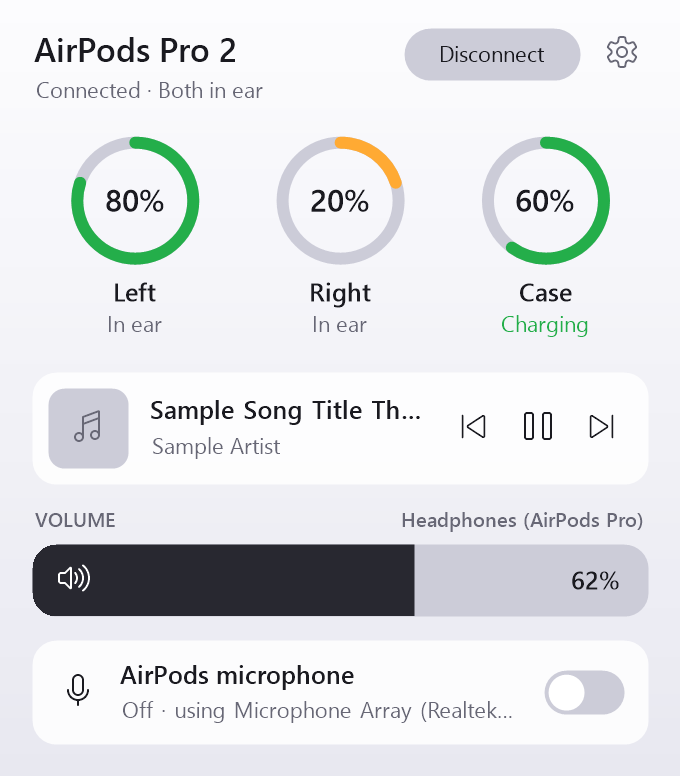
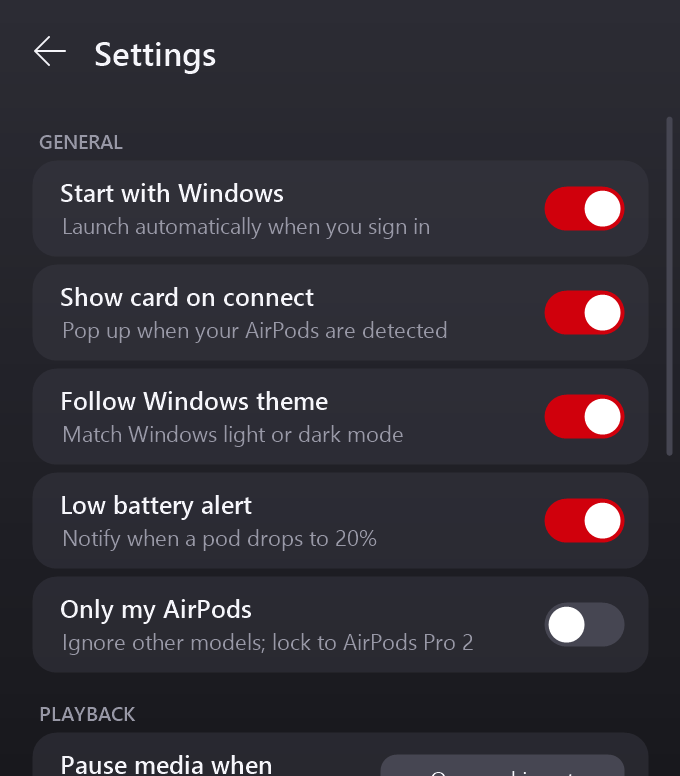
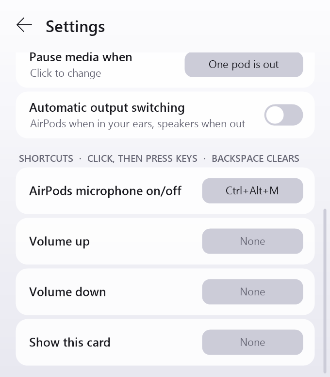

<p align="center">
  
</p>

<h1 align="center">PodBar</h1>

<p align="center">
  <b>AirPods controls for Windows 10 and 11.</b><br>
  Battery levels, ear detection, automatic pause, one-click connect, and a microphone switch, in a small tray app.<br>
  Free, open source, no driver, no account.
</p>

<p align="center">
  <a href="../../releases/latest"><b>Download PodBar-Setup.exe</b></a>
</p>

<p align="center">
  
  
</p>

## What it does

On a Mac, AirPods show their battery, pause when you take one out, and connect with a click. On Windows they are just a Bluetooth headset. PodBar adds the missing pieces:

- **AirPods battery on Windows** – left pod, right pod and charging case, with charging status, in the system tray and on a pop-up card.
- **Ear detection and automatic pause** – music or video pauses when you take a pod out and resumes when you put it back. Choose between pausing when one pod is out, when both are out, or never.
- **Connect and disconnect** – one button, instead of digging through Windows Bluetooth settings.
- **AirPods microphone switch** – turn the AirPods microphone off so Windows keeps them in high-quality stereo mode, and back on when you need it for a call.
- **Now playing controls** – album art, title, artist, and previous / play-pause / next for whatever is playing.
- **Volume slider** for the AirPods.
- **Connection card** – pops up when your AirPods are detected, like on a Mac or iPhone.
- **Low battery notification** when a pod drops to 20%.
- **Automatic output switching** (optional) – AirPods when they are in your ears, your speakers when they are not.
- **Global keyboard shortcuts** for the microphone switch, volume and the card.
- **Light and dark theme**, following Windows and your accent colour.
- **Start with Windows** (optional).

<p align="center">
  
  
</p>

## Install

1. Download **PodBar-Setup.exe** from the [latest release](../../releases/latest).
2. Run it and confirm. PodBar installs for your Windows account only, so it does not ask for administrator rights.
3. Look for the PodBar icon in the system tray (it may be under the `^` arrow). Left-click for the card, right-click for the menu.

The exe is self-contained: you do not need to install .NET.

**Windows SmartScreen warning:** the exe is not code-signed, so Windows may show "Windows protected your PC" the first time. Click **More info**, then **Run anyway**. If you would rather not trust a download, [build it from source](#build-from-source).

**Uninstall:** Settings > Apps > Installed apps > PodBar > Uninstall.

**Requirements:** 64-bit Windows 10 (version 2004 or later) or Windows 11, a Bluetooth adapter with Bluetooth LE, and AirPods paired with the PC.

## Supported AirPods

PodBar has been tested with **AirPods Pro 2**. It also recognises the broadcasts of AirPods (1st, 2nd, 3rd generation), AirPods 4, AirPods Pro, AirPods Pro 2 (USB-C) and AirPods Max, but those have not been tested yet. If you try one, please [open an issue](../../issues) and say how it went.

Connect, volume and the microphone switch find your AirPods by the word "AirPods" in the Windows device name. If you renamed them to something without it, those controls fall back to your default audio devices.

## What it cannot do

- **Noise control (ANC / Transparency / Adaptive).** Switching modes uses Apple's private protocol over a Bluetooth channel that Windows does not open to normal apps. It needs a kernel driver, and loading a self-built driver means turning off Secure Boot and enabling Windows test mode. PodBar deliberately stays driver-free. You can still switch modes by pressing and holding the stem of your AirPods.
- **Exact battery percentage.** AirPods broadcast battery in steps of 10%.
- **Case battery while both pods are out.** The case only reports its battery when a pod is inside or the lid is open.
- **Instant ear detection.** PodBar reads the in-ear state from Bluetooth broadcasts, which arrive about once a second, so pausing takes roughly a second.
- **Telling your AirPods from someone else's of the same model.** It ignores weak signals and can lock to your model ("Only my AirPods"), but an identical pair right next to you can still show up.
- **Spatial audio and automatic switching between Apple devices.**

## How it works

PodBar uses only standard, user-mode Windows APIs:

| Feature | How |
|---|---|
| Battery, charging, in-ear state | Reads the Bluetooth LE "proximity pairing" advertisements that AirPods broadcast (Apple manufacturer ID `0x004C`), using `BluetoothLEAdvertisementWatcher`. Nothing is sent to the AirPods. |
| Pause, resume, now playing | Windows media session API (`GlobalSystemMediaTransportControlsSessionManager`), the same one behind the Windows media flyout. |
| Volume | Windows Core Audio (`IAudioEndpointVolume`). |
| Microphone switch, output switching | Changes the Windows default recording / playback device through `IPolicyConfig`, the interface the Windows sound settings use. It is undocumented but has been stable for many Windows versions. |
| Connect, disconnect | Sends the Bluetooth audio driver the same reconnect / disconnect request the Windows sound flyout sends (`IKsControl`). |

The broadcast format is decoded in [`AirPodsParser.cs`](AirPodsParser.cs).

## Privacy

PodBar makes no network connections and collects nothing. Settings are stored in `%AppData%\PodBar\settings.json`.

## Build from source

You need the [.NET 10 SDK](https://dotnet.microsoft.com/download) on Windows.

```powershell
git clone https://github.com/themmfa/PodBar.git
cd PodBar
dotnet run -c Release
```

To build the release installer into `dist\`:

```powershell
powershell -File tools\build-release.ps1
```

Useful switches for development:

- `PodBar.exe --log C:\path\log.txt` writes every received broadcast and every decision to a log file.
- `PodBar.exe --preview C:\folder` renders the card with sample data to PNG files (this is how the screenshots above are made).
- `PodBar.exe --install` and `PodBar.exe --uninstall` run the built-in installer; add `--silent` to skip the dialogs.

## FAQ

**My AirPods are not detected.**
Make sure Bluetooth is on and the AirPods are out of a closed case, or the case lid is open. PodBar ignores weak signals, so keep them near the PC. Start PodBar with `--log` to see what it receives.

**The battery shows "–".**
That value is not being broadcast at the moment. The case shows "–" when both pods are out of it; a pod can show "–" briefly after it is taken out.

**The sound is bad when I use the AirPods microphone.**
That is a Bluetooth limitation, not PodBar: while the microphone is in use, Windows switches the AirPods to hands-free mode, which has low audio quality. Turn the AirPods microphone off in PodBar to use another microphone and keep stereo quality.

**Does it work with Beats?**
Some Beats models broadcast in the same format and may show battery levels, but this is untested.

## Contributing

Bug reports, test results with other AirPods models, and pull requests are welcome. The code is plain C# with Windows Forms and has no dependencies beyond the .NET SDK.

## License

[MIT](LICENSE)

PodBar is an independent project and is not affiliated with, authorised by, or endorsed by Apple Inc. AirPods, AirPods Pro, AirPods Max and Beats are trademarks of Apple Inc.

The broadcast format was documented by earlier open-source projects, in particular [AirPodsDesktop](https://github.com/SpriteOvO/AirPodsDesktop), [OpenPods](https://github.com/adolfintel/OpenPods) and [LibrePods](https://github.com/librepods-org/librepods).
